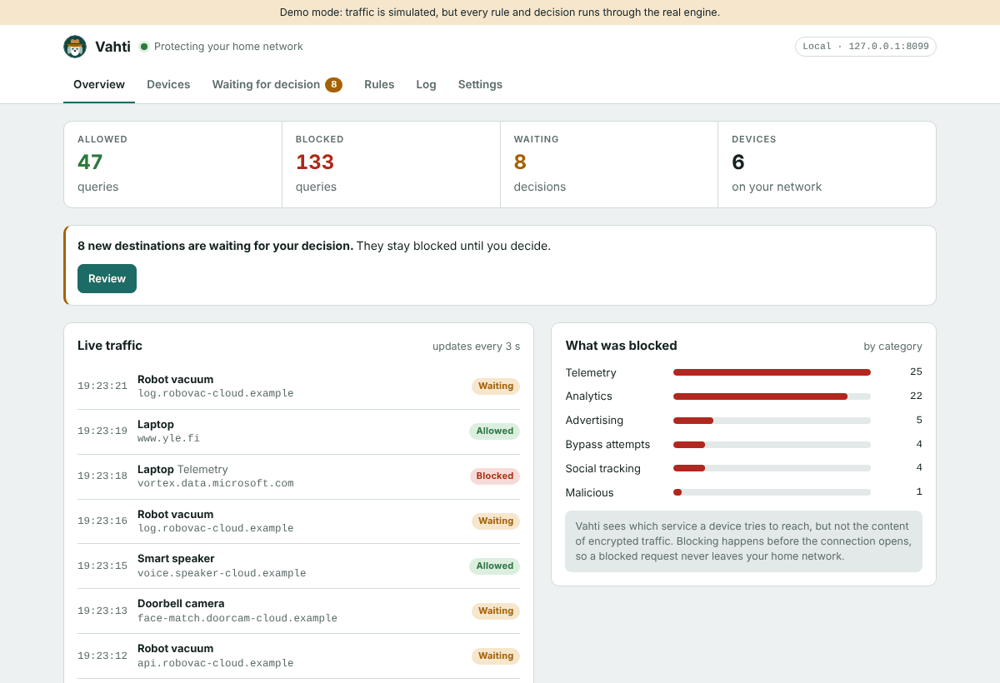
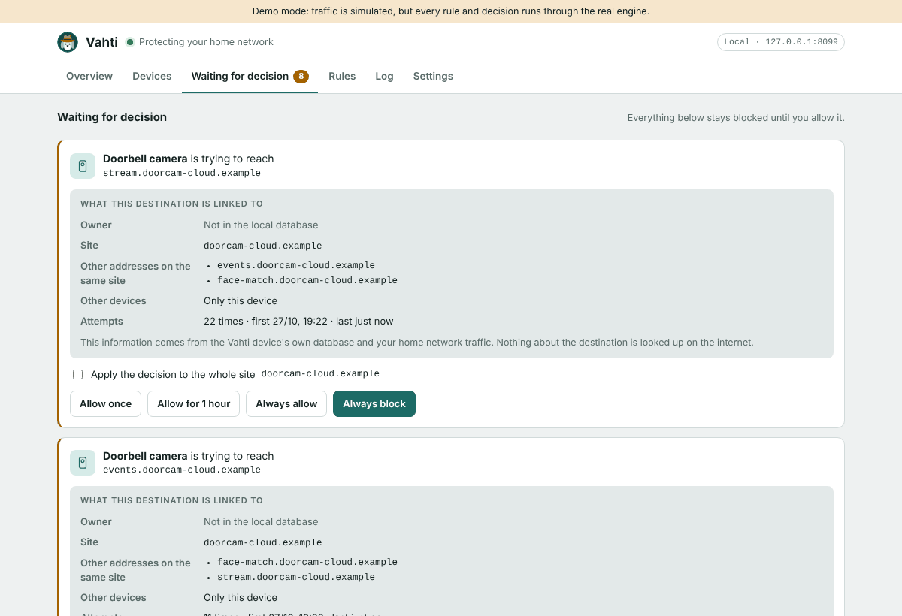
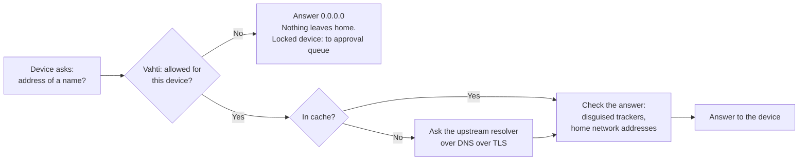

<p align="center">
  
</p>

<h1 align="center">Vahti</h1>

<p align="center">
  A local privacy filter for the home network. It shows what your devices try to reach and lets you decide, device by device, what may leave your home.
</p>

<p align="center">
  <a href="https://github.com/EliasNiskanen/vahti/actions/workflows/ci.yml"></a>
  <a href="https://github.com/EliasNiskanen/vahti/actions/workflows/codeql.yml"></a>
  <a href="LICENSE"></a>
  
  
</p>

<p align="center">
  
</p>

*Vahti* is Finnish for "guard" or "watch".

> [!IMPORTANT]
> **Vahti is a hobby project in development (pre-release).** Do not rely on it as critical protection. It has not had an external security audit, and it has not yet been run on a real Raspberry Pi or Windows computer. See [Project status](#project-status) for exactly what has and has not been tested.

## The problem

Smart TVs, robot vacuums, doorbell cameras and phone apps send data to analytics, advertising and telemetry services all the time. The owner rarely sees where the data goes, and most devices offer no way to stop it.

Vahti makes that traffic visible and controllable. It acts as the home network's DNS server: before any device connects to a service, it has to ask Vahti for the service's address. Vahti checks each request against blocklists and the owner's own rules. A blocked request never leaves the home network.

Everything runs on a small computer at home. Vahti has no cloud service, no user account and no remote management, and it sends no data to anyone.

## Features

- **Blocks tracking before the connection opens.** Advertising, analytics, telemetry and malicious destinations are blocked by default.
- **Recognises devices** and shows what each one has tried to reach.
- **Three modes per device:**
  - *Open*: known tracking services are blocked and everything else works. Suits phones and computers.
  - *Learning*: the device works freely for a while and Vahti records what it needs. Afterwards the device is locked.
  - *Locked*: only allowed destinations work. New destinations wait for the owner's decision. Suits smart devices.
- **Approval queue.** Each waiting destination shows its owner, other addresses on the same site and other devices that use it. The owner can allow it once, for an hour or permanently, or block it.
- **Disguised tracking detection.** If a site's own address is an alias (CNAME) for a tracking service, Vahti blocks it.
- **Bypass protection.** Browsers' own encrypted DNS and iCloud Private Relay are switched off, and known public encrypted DNS services are blocked.
- **Fast answers.** A cache with serve-stale and prefetch answers most queries in well under a millisecond. A speed panel shows the measured answer times.
- **Experimental Windows mode** that filters a single Windows computer and restores its DNS settings automatically.

<p align="center">
  
</p>

## How it works



1. A device asks Vahti for the address of a name.
2. Vahti identifies the device and checks the name against the device's rules, the device's mode and the blocklist categories.
3. A blocked name gets the answer `0.0.0.0` at once, so the device never connects. If the device is locked, the name also goes to the approval queue.
4. An allowed name is answered from the cache or forwarded to the upstream resolver over DNS over TLS. The answer is checked for disguised trackers (CNAME) and for addresses inside the home network (DNS rebinding) before it is returned.

Vahti sees *where* a device connects, not the content of encrypted traffic. It never breaks encryption. The full threat model is in [docs/security-model.md](docs/security-model.md).

## Technologies

| Area | What is used |
|---|---|
| Language and runtime | Go 1.24, a single static binary with no runtime dependencies (about 5,000 lines of Go plus about 1,300 lines of tests) |
| Go libraries | [miekg/dns](https://github.com/miekg/dns) for the DNS server and client, `golang.org/x/crypto` for Argon2id password hashing, `golang.org/x/net` for the public suffix list. Everything else is the Go standard library. |
| Protocols | DNS over UDP and TCP, DNS over TLS to the upstream resolver, EDNS(0), RFC 8767 serve-stale, HTTPS with a self-signed certificate checked by fingerprint |
| Web interface | Plain HTML, CSS and JavaScript with no framework and no build step. The DOM is built with `createElement` only (no `innerHTML`), under a strict Content Security Policy. Embedded in the binary. |
| Security | Argon2id passwords, `__Host-` session cookies, CSRF tokens, Origin and Sec-Fetch-Site checks, Host header checks against DNS rebinding, login throttling, per-client rate limiting, bounded memory for devices, rules and logs |
| Linux service | systemd with sandboxing (no root, limited capabilities, read-only system), `sd_notify` watchdog, atomic state files with a backup copy, a data directory lock |
| Windows | PowerShell module that backs up and restores DNS settings, a start-up task that restores DNS after a crash, access-controlled files in `%ProgramData%` |
| Install scripts | POSIX shell (`install.sh`, `uninstall.sh`, `prepare-laptop.sh`) |
| Testing | Go unit tests with the race detector, fuzz tests for the list parser and DNS handling, simulated Windows network adapters for the PowerShell restore logic |
| CI and supply chain | GitHub Actions, gofmt, go vet, staticcheck, govulncheck, CodeQL, shellcheck, Dependabot, actions pinned by commit hash |
| Releases | Builds for Raspberry Pi (arm64 and armv7), x86-64 Linux and Windows, SHA-256 checksums, a CycloneDX software bill of materials and signed build provenance attestations |
| Hardware | Raspberry Pi 4 or 5, an old laptop or any always-on Linux computer ([hardware guide](docs/hardware.md)) |

## Design decisions

- **Local only.** Vahti never sends data about the home network anywhere. The only outbound connections are allowed DNS queries, encrypted, and blocklist downloads that the owner starts.
- **Filter before forwarding.** The decision is made before the query reaches the internet, so a blocked name is never even looked up.
- **Fail closed.** If Vahti stops, names stop resolving. Filtering is never bypassed silently. systemd restarts Vahti if it crashes or stops answering.
- **Few dependencies.** Three Go modules besides the standard library, all widely used. This keeps the code that needs reviewing small.
- **Bounded resources.** The cache, logs, device list and rules all have limits, so a misbehaving device cannot fill the memory.
- **The log stays in memory.** Query history is never written to disk.

## Project status

Vahti is at version 0.1 (pre-release). The core works in demo mode and in automated tests. It has not yet been used on a real home network.

| Part | Status |
|---|---|
| Filtering DNS server, cache, serve-stale and prefetch | Done, covered by automated tests |
| Device modes, rules and the approval queue | Done, covered by automated tests |
| Web interface | Done, checked in demo mode in desktop and phone layouts |
| Linux installer and systemd service | Written and checked with shellcheck, **not yet run on a real Raspberry Pi or laptop** |
| Windows mode | Restore logic tested with simulated network adapters, **not yet run on a real Windows computer** |
| Release pipeline | Builds, checksums and attestations work. The first release (v0.1.0) is a draft and not yet published. |
| External security audit | Not done |

## Roadmap

The goal of the next steps is a package that installs and runs reliably on a Raspberry Pi 5 and that devices cannot easily get around.

**1. A working package on real hardware**
- Install and run Vahti on a Raspberry Pi 5 and on an old laptop. Fix what that reveals.
- Run Windows mode on a real Windows computer.
- Publish the v0.1.0 release with downloadable packages.

**2. Detect bypasses**
- Warn about devices that are online but never ask Vahti anything (they probably use their own DNS).
- Detect when the router advertises its own DNS server over IPv6, which is the most common silent bypass.
- Show devices that try to use encrypted DNS.

**3. Router guides**
- Step-by-step guides for common routers: send all DNS traffic (port 53) to Vahti and block encrypted DNS (port 853).
- A check in Vahti that shows whether the redirect works.

**4. Gateway mode (experimental)**
- Vahti between the modem and the home network, with two network ports.
- Linux nftables rules for redirecting DNS, blocking known encrypted DNS and VPN endpoints per device, and for locked devices, allowing connections only to addresses that Vahti itself has just given out. Packets are routed by the Linux kernel, not by Vahti, so the connection stays fast.
- A setting for what happens if Vahti fails: let traffic through or stop it.

**5. Towards 1.0**
- An external security review.
- In-place updates and backup and restore of settings.

The version history is in [CHANGELOG.md](CHANGELOG.md).

## Try it

Demo mode runs on any computer with [Go](https://go.dev/dl/) 1.24 or newer. The traffic is simulated, but every decision runs through the real filtering engine, and nothing is sent to the internet.

```sh
git clone https://github.com/EliasNiskanen/vahti.git
cd vahti
go build -o vahti ./cmd/vahti
./vahti demo
```

Open http://127.0.0.1:8080 and enter the setup code printed in the terminal. You can also query the demo DNS server directly: `dig @127.0.0.1 -p 5353 doubleclick.net`.

> [!WARNING]
> **Installing Vahti for real changes your DNS settings.** Once your router or computer uses Vahti as its DNS server, the internet works only while Vahti is running. Read [Changing and restoring DNS settings](docs/installation.md#changing-and-restoring-dns-settings) before you start.

## Documentation

| Guide | Contents |
|---|---|
| [Installation](docs/installation.md) | Installing on Linux, changing and restoring DNS settings, monitoring other people's traffic |
| [Hardware](docs/hardware.md) | Requirements, suitable devices and a parts list for a Raspberry Pi 5 |
| [Old laptop](docs/old-laptop.md) | Preparing an old laptop to run Vahti around the clock |
| [Windows mode](docs/windows.md) | Filtering one Windows computer, and how DNS is restored |
| [Configuration](docs/configuration.md) | All settings in `/etc/vahti/config.json` |
| [Security model](docs/security-model.md) | What Vahti protects against and what it does not |
| [Publishing](docs/publishing.md) | Repository settings and release steps |

## Development

```sh
make test     # tests with the race detector
make check    # tests, go vet and formatting
make pi       # build for Raspberry Pi
```

| Folder | Contents |
|---|---|
| `cmd/vahti` | Program start-up and commands (`run`, `demo`, `local`, `update-lists`, `reset-admin`) |
| `internal/dnsserver` | The filtering DNS server: cache, encrypted forwarding, CNAME and rebinding checks |
| `internal/engine` | Decision logic: devices, rules, approval queue, log |
| `internal/intel` | Tracker recognition and ownership data, blocklist parsing |
| `internal/metrics` | Answer time measurements for the speed panel |
| `internal/web` | Web interface and API: sign-in, sessions, CSRF protection |
| `deploy` | Installer and sandboxed systemd services |
| `deploy/windows` | PowerShell scripts for Windows mode |
| `docs` | Guides and the security model |

## Security

Found a vulnerability? Do not open a public issue. See [SECURITY.md](SECURITY.md).

## License

Apache License 2.0. The software is provided as is, without warranty (see [LICENSE](LICENSE)).

The blocklists have their own licenses: StevenBlack/hosts (MIT) and URLhaus (CC0). If you add lists, check their terms. Some tracker databases allow only non-commercial use.

The project is maintained by [Elias Niskanen](https://github.com/EliasNiskanen) in his free time. Issues are answered and problems fixed when possible, without a promised schedule.
